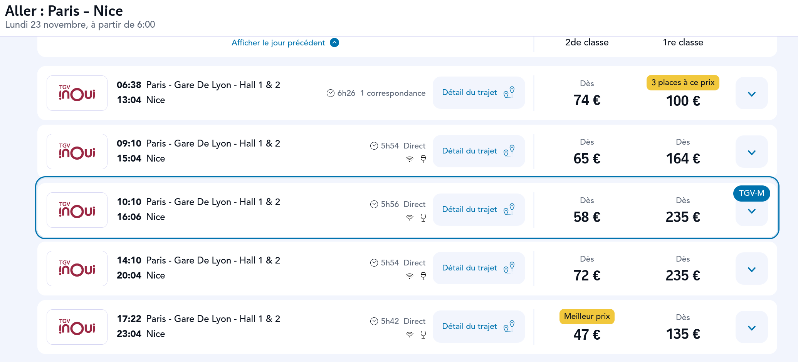

# TGV-M finder for SNCF Connect

Step 1: install a userscript manager like Tampermonkey 

Step 2: click this link: [content.user.js](https://raw.githubusercontent.com/bovine3dom/tgvm-pls/master/content.user.js)

Step 3: Go to SNCF Connect and search between (at the time of writing) Paris and Marseille or Nice

Step 4: Make your life easier by setting "Type of train" to "TGV INOUI"

TGV-Ms will get a nice little blue box around them. There is around one per day per direction from Nov 9th for Marseille and Nov 24th for Nice. They leave Paris in the mid-morning and Marseille/Nice in the mid-afternoon.
